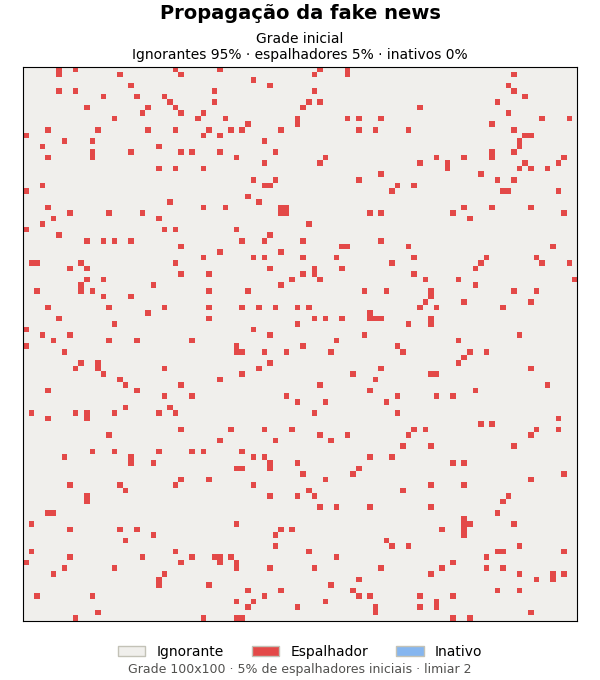
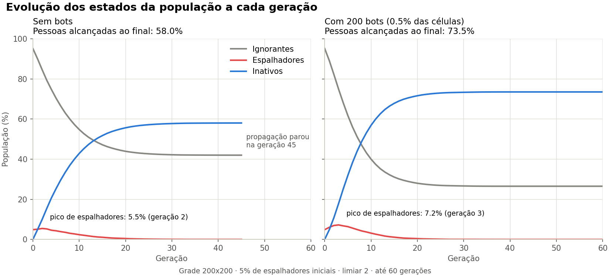

# Propagação de Fake News em Sistemas Paralelos e Distribuídos

Trabalho da disciplina de Sistemas Distribuídos (ES45A.2026_02.ES51), UTFPR Cornélio Procópio.

Simulação de propagação de fake news como um autômato celular, implementada em versão sequencial, paralela (`threading` e `multiprocessing`) e distribuída (`socket`), usando a biblioteca padrão do Python no cálculo.

## Integrantes

- Leonardo Marino Scarparo Silva (RA 2707012)
- Vinicius Luiz Andretta Ferracini (RA 2707110)
- Arthur Henrique de Melo Almeida (RA 2706920)
- Willian Kiyoshi Onuki (RA 2151456)

## Modelo

Cada célula da grade representa uma pessoa em um de três estados:

- **0 — Ignorante**: ainda não recebeu a informação.
- **1 — Espalhador**: recebeu e está espalhando.
- **2 — Inativo**: já espalhou e parou.

A cada geração, considerando a vizinhança de Moore (8 vizinhos, sem voltar pela borda):

- Um Ignorante vira Espalhador se tiver pelo menos `limiar_convencimento` vizinhos espalhadores.
- Um Espalhador vira Inativo na geração seguinte.
- Um Inativo permanece Inativo.

## Como rodar

Requer Python 3.12 ou mais novo, sem dependências externas para o cálculo. A biblioteca `matplotlib`, presente em `requirements.txt`, é utilizada somente para os gráficos dos experimentos.

### Versão sequencial

```bash
python sequencial.py --linhas 100 --colunas 100 --geracoes 50 --percentual 0.05 --limiar 2
```

Opções principais:

- `--limiar`: quantidade de vizinhos espalhadores necessária para convencer um ignorante.
- `--sem-parada-antecipada`: executa todas as gerações.
- `--sem-impressao`: desativa a impressão de resultados por geração.
- `--salvar-grade arquivo.grade`: salva a grade inicial.
- `--arquivo-grade arquivo.grade`: carrega uma grade inicial de um arquivo.

### Versões paralelas locais

As duas versões paralelas aceitam as mesmas opções principais da versão sequencial,
incluindo `--arquivo-grade`, `--salvar-grade`, `--limiar`, `--semente`,
`--probabilidade` e `--trabalhadores`.

```bash
python paralelo_threads.py --linhas 100 --colunas 100 --geracoes 50 --limiar 2 --trabalhadores 4
python paralelo_processos.py --linhas 100 --colunas 100 --geracoes 50 --limiar 2 --trabalhadores 4
```

Para comparar as versões partindo da mesma entrada, salve uma grade com a
sequencial e passe o arquivo às duas versões paralelas. Use
`--sem-parada-antecipada --sem-impressao` para executar um número fixo de
gerações e reduzir o custo de saída no terminal.

`paralelo_threads.py` reparte faixas de linhas entre threads e sincroniza cada
geração com uma barreira. Como o cálculo é Python puro, o GIL pode limitar o
ganho de desempenho das threads. `paralelo_processos.py` mantém processos
trabalhadores ativos durante a simulação e compartilha os dois buffers da grade
com `multiprocessing.shared_memory`, evitando copiar a grade por pickle a cada
geração.

O argumento opcional `--probabilidade` define a chance de cada contato com um
espalhador convencer uma célula ignorante (padrão `1.0`, que reproduz a regra
determinística). No modo probabilístico, `--semente` torna o resultado
reproduzível e independente da quantidade de trabalhadores.

### Experimento de threads e processos

Execute o benchmark na mesma máquina e com a mesma entrada para comparar o
efeito do GIL com o custo de criação e sincronização dos processos:

```bash
python experimentos/comparar_paralelismo.py --linhas 100 --colunas 100 --geracoes 20 --repeticoes 3 --trabalhadores 1 2 4
```

O script roda as duas implementações com cada quantidade de trabalhadores,
mede cada execução com `time.perf_counter()` e grava os tempos individuais,
medianas, speedup e eficiência em `experimentos/tempos_paralelismo.csv`. Ele
usa a mesma grade e semente para cada configuração; não inclui tempos
estimados. Execute o benchmark na máquina da apresentação e use os valores
gerados no CSV para os gráficos e slides.

Referências técnicas: [threading e GIL](https://docs.python.org/3.14/library/threading.html),
[memória compartilhada](https://docs.python.org/3.14/library/multiprocessing.shared_memory.html)
e [`time.perf_counter`](https://docs.python.org/3.14/library/time.html#time.perf_counter).

### Versão distribuída

A versão distribuída utiliza comunicação TCP com sockets. O coordenador divide a grade em blocos de linhas e envia cada bloco para um trabalhador. Durante a simulação, os trabalhadores trocam diretamente as linhas de fronteira com seus vizinhos para calcular as gerações corretamente.

Para executar localmente, abra terminais separados.

**Terminal 1 — Coordenador:**

```bash
python -m distribuida.coordenador --trabalhadores 2 --linhas 20 --colunas 20 --geracoes 5
```

**Terminal 2 — Trabalhador 1:**

```bash
python -m distribuida.trabalhador --id 1 --porta-vizinho 5001
```

**Terminal 3 — Trabalhador 2:**

```bash
python -m distribuida.trabalhador --id 2 --porta-vizinho 5002
```

Inicie primeiro o coordenador e depois os trabalhadores.

É possível alterar a quantidade de trabalhadores. Por exemplo, para quatro trabalhadores, utilize `--trabalhadores 4` no coordenador e inicie os processos com IDs de 1 a 4, cada um usando uma porta diferente.

A grade final é salva no arquivo `grade_distribuida.bin`.

## Testes

Para executar os testes automatizados:

```bash
python -m unittest discover -v
```

Os testes `testes/testar_paralelo_vinicius.py` comparam threads e processos à
função sequencial comum e verificam que a probabilidade não muda quando o
número de faixas é alterado.

Os testes `testes/testar_melhorias.py` verificam as melhorias de bots e estatísticas:
sem bots, a simulação é idêntica à sequencial; os bots nunca ficam inativos; e as
estatísticas batem com valores calculados à mão.

Os testes `testes/testar_distribuida.py` levantam um coordenador e trabalhadores
reais conectados por sockets TCP em `127.0.0.1` (com 1, 2 e 4 trabalhadores) e
comparam a grade final com o cálculo sequencial puro, confirmando que trocar as
fronteiras diretamente entre vizinhos não muda o resultado do modelo.

Também é possível verificar a compilação dos arquivos Python:

```bash
python -m py_compile sequencial.py paralelo_threads.py paralelo_processos.py comum/*.py distribuida/*.py experimentos/*.py
```

Os testes verificam se a divisão da grade em faixas de linhas mantém o mesmo resultado do cálculo da grade inteira e se a versão refatorada preserva o comportamento do código original fornecido pelo professor (`original/FakeNews.py`).

Além disso, foram realizados testes de comparação entre as versões sequencial e distribuída, utilizando dois e quatro trabalhadores, verificando que as grades finais são idênticas.

## Estrutura

```text
comum/
├── __init__.py
├── modelo.py
├── grade.py
└── probabilidade.py

distribuida/
├── __init__.py
├── protocolo.py
├── coordenador.py
└── trabalhador.py

testes/
├── __init__.py
├── testar_correcao.py
├── testar_paralelo_vinicius.py
├── testar_melhorias.py
└── testar_distribuida.py

experimentos/
├── comparar_paralelismo.py
├── executar_experimentos.py
├── medir_coordenador.py
├── medir_trabalhador.py
└── gerar_graficos.py

melhorias/
├── bots.py
├── probabilidade.py
├── animacao.py
├── estatisticas.py
├── graficos_estatisticas.py
└── saidas/

original/
└── FakeNews.py

sequencial.py
paralelo_threads.py
paralelo_processos.py
experimentos/comparar_paralelismo.py
README.md
requirements.txt
.gitignore
```

## Melhoria 1 — Grade em `bytearray` e duas grades alternadas

**O que é.** O código original cria uma nova grade a cada geração com `deepcopy(grade)` e depois sobrescreve as células que mudaram. A refatoração usa a grade como um único `bytearray` (1 byte por célula, índice `linha * colunas + coluna`) e mantém duas grades que trocam de papel a cada geração (`atual, proxima = proxima, atual`), eliminando a cópia.

**Por que foi feita.** `deepcopy` em uma lista de listas percorre e recria cada sublista recursivamente, o que é caro em Python puro, além de não ser necessário: basta ter dois buffers e alternar entre eles.

**Como foi implementada.** `comum/modelo.py` define a função única de cálculo (`calcular_intervalo`), usada pelas versões do projeto. Ela lê de um `bytearray` e escreve em outro. `sequencial.py` cria os dois buffers uma única vez e só troca os papéis entre gerações.

**Impacto medido.** Comparando `original/FakeNews.py` com a versão refatorada, nas mesmas condições (30 gerações fixas, sem parada antecipada, sem impressão, 5% de espalhadores iniciais, limiar 2, `time.perf_counter()`, Python 3.14.5):

| Grade | Original (ms/geração) | Refatorado (ms/geração) | Speedup |
| --- | --- | --- | --- |
| 300 x 300 | 85,26 | 76,96 | 1,11x |
| 500 x 500 | 250,07 | 225,05 | 1,11x |
| 1000 x 1000 | 1012,78 | 918,23 | 1,10x |

O ganho medido (cerca de 10%) é bem menor do que estimativas informais iniciais, e a diferença é explicada principalmente pelo custo do próprio `deepcopy`. Medido isoladamente, ele leva cerca de 8,8 ms por chamada em uma grade 300 x 300 e escala com o número de células. A contagem de vizinhos (vizinhança de Moore) continua sendo o principal custo do cálculo em Python puro.

## Contribuição individual — Leonardo Marino Scarparo Silva

Responsável pela base do projeto, sobre a qual as demais versões são construídas:

- **`comum/modelo.py`**: definição dos três estados e da função `calcular_intervalo`, que calcula a próxima geração para um intervalo de linhas de uma grade `bytearray` e devolve a contagem de cada estado nesse intervalo.
- **`comum/grade.py`**: criação da grade inicial com semente fixa (`criar_grade`) e gravação/leitura em arquivo (`salvar_grade`/`carregar_grade`).
- **`sequencial.py`**: versão sequencial refatorada, com duas grades alternadas em vez de `deepcopy`, contagem de estados feita durante o cálculo e opções de linha de comando para configurar a simulação.
- **`testes/testar_correcao.py`**: testes automatizados que comparam a refatoração com o código original e verificam se a divisão do cálculo em faixas de linhas preserva o resultado.
- **Melhoria 1** (`bytearray` e duas grades alternadas): implementação e medição de desempenho descritas na seção acima.
- Organização inicial do repositório (estrutura de pastas, `.gitignore`, `requirements.txt`) e abertura do primeiro Pull Request (`sequencial` → `main`).

## Contribuição individual — Vinicius Luiz Andretta Ferracini

- **`paralelo_threads.py`**: divide a grade em faixas de linhas para threads e sincroniza cada geração com uma barreira.
- **`paralelo_processos.py`**: mantém processos trabalhadores e dois buffers de grade em `multiprocessing.shared_memory`.
- **`comum/probabilidade.py`**: aplica chance de convencimento com sorteio determinístico por geração e célula, mantendo os resultados reproduzíveis entre partições.
- **`testes/testar_paralelo_vinicius.py`**: compara os resultados das versões paralelas com o cálculo sequencial comum e verifica consistência entre faixas.
- **`experimentos/comparar_paralelismo.py`**: mede tempos de threads e processos e grava tempos, medianas, speedup e eficiência em CSV para análise do efeito do GIL.
- **Melhorias**: comparação entre threads e processos e probabilidade de convencimento configurável.

## Melhoria 2 — threads contra processos (efeito do GIL)

**O que é.** Comparação direta, na mesma máquina e com a mesma entrada, entre
`paralelo_threads.py` e `paralelo_processos.py`, com 1, 2, 4 e 8 trabalhadores.

**Por que foi feita.** O enunciado libera `threading` mesmo sabendo que, em
Python puro, o GIL deixa só uma thread executar bytecode por vez. Medir as
duas variantes com o mesmo código de cálculo transforma essa limitação da
linguagem numa análise com números, em vez de uma afirmação sem evidência.

**Como foi implementada.** `experimentos/comparar_paralelismo.py` roda as duas
implementações várias vezes para cada quantidade de trabalhadores, mede com
`time.perf_counter()` e grava tempos individuais, medianas, speedup e
eficiência em `experimentos/tempos_paralelismo.csv`. O mesmo efeito aparece de
novo, em outra máquina e outro cenário, nos experimentos completos da seção
seguinte.

**Impacto medido** (cenário base, grade 500 x 500, 30 gerações, 5%, limiar 2 —
tabela completa na seção "Experimentos de desempenho"):

| Trabalhadores | Threads (speedup) | Processos (speedup) |
| --- | --- | --- |
| 1 | 0,99x | 0,95x |
| 2 | 1,04x | 1,74x |
| 4 | 1,03x | 2,92x |
| 8 | 0,99x | 3,47x |

Com threads, o speedup nunca passa de 1,04x, porque o GIL faz as threads se
revezarem em vez de calcular em paralelo; a eficiência cai como `1/p`. Com
processos, cada um tem o próprio interpretador e o speedup chega a 3,47x com 8
processos, ao custo de criar os processos e sincronizar a barreira a cada
geração.

**Referência.** AMDAHL (1967), sobre o limite que a parte não paralelizável
impõe ao speedup, e a documentação oficial do módulo `threading` (ver seção
"Versões paralelas locais"), sobre o Global Interpreter Lock.

## Melhoria 3 — probabilidade de convencimento

**O que é.** Em vez de um vizinho espalhador sempre contar para o limiar de
convencimento, cada contato só convence com probabilidade `p` (parâmetro
`--probabilidade`, de 0 a 1). Com `p = 1,0` a regra volta a ser a
determinística original.

**Por que foi feita.** A certeza da regra original (um vizinho espalhador
sempre convence) é uma simplificação forte frente aos modelos de boato da
literatura, que tratam o contato como uma chance de convencimento, não uma
garantia (Daley; Kendall, 1964; Maki; Thompson, 1973). Tornar isso um
parâmetro também permite estudar o quanto o alcance da fake news depende da
sua "força de persuasão".

**Como foi implementada.** `comum/probabilidade.py` usa um gerador de
contador (hash do tipo SplitMix64): o sorteio de cada contato depende só da
semente, da geração, da linha, da coluna e do número do vizinho — nunca de
qual trabalhador calculou a célula. Essa é a técnica descrita por Salmon et
al. (2011) para números aleatórios paralelos reprodutíveis, necessária para
que dividir a grade em mais ou menos faixas continue dando exatamente o mesmo
resultado (testado em `testes/testar_paralelo_vinicius.py`, com 1, 2, 4 e 7
faixas, e com threads e processos). `paralelo_threads.py` e
`paralelo_processos.py` aceitam `--probabilidade`; `melhorias/probabilidade.py`
mede o alcance final para vários valores de `p` na mesma grade.

**Impacto medido** (grade 200 x 200, 5% de espalhadores iniciais, semente 42,
até 200 gerações — `python melhorias/probabilidade.py --limiar 1`):

| Probabilidade | Alcance final | Gerações até parar |
| --- | --- | --- |
| 0,1 | 13,5% | 12 |
| 0,3 | 90,4% | 24 |
| 0,5 | 99,6% | 12 |
| 1,0 (determinística) | 100,0% | 10 |

Com limiar 2 (o usado no resto do projeto), o efeito é bem mais drástico: como
um ignorante precisa de **dois** contatos bem-sucedidos na mesma geração, a
propagação quase não sai do chão para `p` entre 0,1 e 0,5 (alcance de 4,9% a
6,6%, contra 58,0% da versão determinística) — o limiar e a probabilidade se
multiplicam, não se somam. A grade final não muda dividindo em 1, 4 ou 8
faixas, confirmando que a probabilidade continua comparável entre a
sequencial, a paralela e a distribuída.

**Referência.** SALMON et al. (2011), sobre geradores de números aleatórios
paralelos baseados em contador; DALEY; KENDALL (1964) e MAKI; THOMPSON (1973),
sobre o papel da chance de contato nos modelos de boato.

```bash
python melhorias/probabilidade.py --linhas 200 --colunas 200 --limiar 1
```

## Contribuição individual — Arthur Henrique de Melo Almeida

- **`distribuida/protocolo.py`**: mensagens com cabeçalho de tamanho fixo e
  conteúdo em JSON (grades em Base64), `receber_exatamente` para tratar o
  `recv` parcial do TCP, e as mensagens de registro, configuração, tarefa,
  fronteira, resultado e encerramento.
- **`distribuida/coordenador.py`**: divide a grade em blocos de linhas, aceita
  a conexão de cada trabalhador, informa a cada um quem são os seus vizinhos
  e por qual porta falar com eles, envia o bloco inicial, recebe o resultado
  final de cada trabalhador e remonta a grade completa.
- **`distribuida/trabalhador.py`**: conecta ao coordenador e aos vizinhos,
  troca as linhas de fronteira **diretamente com os vizinhos** a cada geração
  (sem passar pelo coordenador), calcula o bloco com a mesma função
  `calcular_intervalo` das outras versões e devolve o resultado.
- **Melhoria 7** (troca direta de fronteiras entre vizinhos): em vez de cada
  trabalhador mandar a borda ao coordenador para ele repassar, os
  trabalhadores abrem conexão entre si (`trocar_fronteiras`), o que reduz o
  número de mensagens e evita que o coordenador seja um gargalo de
  comunicação — analisado com números medidos na seção "Comunicação" dos
  experimentos de desempenho.
- Revisão dos Pull Requests do Willian.

## Experimentos de desempenho

**O que medem.** Os mesmos cenários são executados em todas as versões, como pede o
enunciado. Cada experimento varia um fator por vez em torno de um cenário base
(grade 500 x 500, 30 gerações, 5% de espalhadores iniciais, limiar 2), e cada
execução é repetida 5 vezes:

| Experimento | O que varia | Trabalhadores nas versões paralelas |
| --- | --- | --- |
| `trabalhadores` | número de threads, processos ou nós | 1, 2, 4 e 8 |
| `tamanho` | grade 250 x 250, 500 x 500 e 1000 x 1000 | 4 |
| `geracoes` | 10, 30 e 60 gerações | 4 |
| `percentual` | 1%, 5% e 20% de espalhadores iniciais | 4 |

**Como os tempos são medidos.**

- Sequencial, threads e processos rodam como programas separados (`subprocess`),
  sempre a partir do mesmo arquivo de grade inicial (gerado com `comum/grade.py`),
  executando todas as gerações (`--sem-parada-antecipada`) e sem imprimir nada por
  geração (`--sem-impressao`). As versões paralelas recebem `--trabalhadores p`.
- O tempo registrado é o que o próprio programa imprime em `Tempo total: X s`, medido
  com `time.perf_counter()` em volta da simulação. A inicialização do Python e a
  leitura da grade ficam de fora.
- A versão distribuída roda na mesma máquina: um coordenador e p trabalhadores, cada um
  num processo, conversando por sockets TCP em `127.0.0.1`. O código da pasta
  `distribuida/` não mede tempo, então os experimentos usam dois scripts que
  reaproveitam as funções dela sem alterá-las:
  - `experimentos/medir_coordenador.py` faz o mesmo que o coordenador e mede o tempo de
    `executar_simulacao` (envio dos blocos, todas as gerações e recebimento dos
    resultados), depois que todos os trabalhadores já se conectaram;
  - `experimentos/medir_trabalhador.py` roda o trabalhador trocando duas funções por
    versões que medem: `calcular_bloco` (tempo de **cálculo**, somado ao longo das
    gerações) e `trocar_fronteiras`, dividida em **comunicação** (o envio das bordas
    aos vizinhos) e **espera** (o tempo bloqueado em `receber_mensagem`, esperando o
    vizinho terminar a própria geração e responder).

  A distribuída cria a grade com `criar_grade` e a mesma semente, então parte
  exatamente da mesma grade dos arquivos. Antes das medições, conferimos que ela chega à
  mesma grade final que a sequencial com 1, 2, 4 e 8 trabalhadores.
- As versões se alternam dentro de cada repetição, para que uma variação da máquina
  (temperatura, frequência da CPU) não prejudique uma versão só. As repetições e o
  desvio padrão seguem a recomendação de sempre relatar a variabilidade das medições
  (Hoefler; Belli, 2015).
- Se um programa falhar ou não imprimir o tempo, o script para em vez de gravar um
  valor inválido no CSV.

**O que cada tempo inclui.** As versões não medem exatamente o mesmo intervalo, e isso
aparece nos resultados. A versão com processos inclui a criação dos processos (com
`spawn`) e da memória compartilhada. A distribuída não inclui a criação dos processos
nem as conexões, porque os trabalhadores já estão conectados quando o tempo começa,
mas inclui a criação da grade pelo coordenador (no máximo 10 ms, na grade 1000 x 1000)
e o envio e o recebimento da grade inteira, codificada em Base64 dentro de mensagens JSON.

O script `experimentos/comparar_paralelismo.py`, do Vinicius, é complementar: compara
só threads e processos, usando a mediana e a própria versão com 1 trabalhador como base.
Os experimentos desta seção comparam as quatro versões com a sequencial.

**Como rodar.** O `matplotlib`, usado só nos gráficos, fica num ambiente virtual:

```bash
python -m venv .venv
source .venv/bin/activate          # no Windows: .venv\Scripts\activate
pip install -r requirements.txt

python experimentos/executar_experimentos.py --maquina notebook --repeticoes 5
python experimentos/gerar_graficos.py --maquina notebook
```

**Arquivos gerados**, em `experimentos/resultados/` e `experimentos/graficos/`:

- `tempos_<maquina>.csv`: uma linha por execução (dado bruto, sem média).
- `ambiente_<maquina>.txt`: configuração experimental (processador, núcleos físicos e
  lógicos, memória RAM, sistema operacional, versão do Python) e os cenários usados.
- `resumo_<maquina>.csv`: média, desvio padrão, speedup e eficiência de cada
  configuração; é a tabela comparativa da apresentação.
- `tempo_por_trabalhadores.png`, `speedup.png`, `eficiencia.png`,
  `tempo_por_tamanho.png`, `tempo_por_geracoes.png`, `tempo_por_percentual.png` e
  `comunicacao.png`. Um gráfico só é gerado quando o CSV tem os dados de que ele precisa.

**Indicadores.** Com p = número de trabalhadores (threads, processos ou nós):

- **Speedup** `S(p) = T_sequencial / T(p)`: quantas vezes a versão é mais rápida que a
  sequencial. O ideal é `S(p) = p`.
- **Eficiência** `E(p) = S(p) / p`: quanto de cada trabalhador foi aproveitado. O ideal
  é 100%; abaixo disso, parte do tempo foi gasta criando threads ou processos,
  sincronizando as gerações, comunicando fronteiras ou esperando faixas mais lentas.

`T_sequencial` é o tempo médio da `sequencial.py` no mesmo cenário, ou seja, é o speedup
absoluto, e não o relativo à própria versão paralela com 1 trabalhador. Por isso
`S(1) < 1` mostra o custo extra da estrutura paralela. As médias e o desvio padrão
amostral são calculados com o módulo `statistics`. As definições seguem Grama et al.
(2003). Na análise, duas leis clássicas ajudam a interpretar os gráficos: a parte do
trabalho que não se divide entre os trabalhadores limita o speedup máximo (Amdahl,
1967), e problemas maiores tendem a aproveitar melhor mais trabalhadores, porque o
cálculo cresce mais que o custo fixo de coordenação (Gustafson, 1988).

**Comunicação.** `experimentos/medir_trabalhador.py` registra três tempos separados,
somados ao longo das gerações e com a média tirada entre os trabalhadores: **cálculo**
(a função que calcula a faixa, igual à sequencial), **comunicação** (só o envio das
linhas de fronteira aos vizinhos) e **espera** (o tempo bloqueado esperando a borda do
vizinho, dominado por ele terminar a própria geração, não pelo tamanho da mensagem). O
CSV grava os três em `tempo_calculo_s`, `tempo_comunicacao_s` e `tempo_espera_s`, e o
gráfico `comunicacao.png` empilha as três partes. Os resultados abaixo foram medidos
antes dessa separação, com comunicação e espera somadas numa só coluna; reexecutar
`executar_experimentos.py` já grava as três colunas.

**Observação para a análise.** O custo de uma geração depende dos dados: só as células
ignorantes contam vizinhos, então, quanto mais a notícia já se espalhou, mais barata fica
a geração. Por isso todas as versões partem da mesma grade, e por isso aumentar o
percentual inicial de espalhadores *diminui* o tempo de execução. O mesmo efeito pode
desbalancear a carga entre os trabalhadores: uma faixa com mais ignorantes demora mais.

### Resultados

Medidos em 23/11/2026 num notebook com Intel Core i5-12450H (8 núcleos físicos: 4 de
desempenho e 4 de eficiência; 12 lógicos), 31,1 GiB de RAM, Ubuntu 22.04.5 e Python
3.10.12. São 245 execuções (5 repetições de cada configuração); os
dados brutos ficam em `experimentos/resultados/tempos_notebook.csv` e a tabela completa
em `resumo_notebook.csv`.

Cenário base (grade 500 x 500, 30 gerações, 5% de espalhadores). Tempo médio, speedup
e eficiência; a sequencial levou **4,33 s** (desvio padrão de 0,17 s):

| Versão | p = 1 | p = 2 | p = 4 | p = 8 |
| --- | --- | --- | --- | --- |
| Threads | 4,39 s · 0,99x · 99% | 4,15 s · 1,04x · 52% | 4,18 s · 1,03x · 26% | 4,38 s · 0,99x · 12% |
| Processos | 4,53 s · 0,95x · 95% | 2,48 s · 1,74x · 87% | 1,48 s · 2,92x · 73% | 1,25 s · 3,47x · 43% |
| Distribuída | 4,39 s · 0,98x · 98% | 2,32 s · 1,86x · 93% | 1,30 s · 3,32x · 83% | 1,05 s · 4,14x · 52% |

**Threads: o GIL impede o ganho.** O speedup fica entre 0,99x e 1,04x com qualquer
número de threads. O cálculo é Python puro, e o GIL deixa só uma thread executar
bytecode por vez, então as threads se revezam em vez de calcular juntas. A eficiência
cai como 1/p (52%, 26%, 12%), o mesmo efeito medido pelo Vinicius em
`comparar_paralelismo.py`.

**Processos: paralelismo real, com custo fixo.** Cada processo tem o seu próprio
interpretador, e o speedup chega a 2,92x com 4 processos e 3,47x com 8. Com 1 processo
a versão é 5% mais lenta que a sequencial (4,53 s contra 4,33 s): é o custo de criar o
processo com `spawn` e a memória compartilhada. A eficiência cai de 73% (p = 4) para
43% (p = 8) por três motivos: o processador só tem 4 núcleos de desempenho (os outros
4 são mais lentos); a barreira de cada geração faz todos esperarem a faixa mais lenta
(o custo depende de quantos ignorantes cada faixa tem); e o custo fixo de criação pesa
mais quando o tempo total diminui (Amdahl, 1967).

**Distribuída: o melhor speedup, com uma ressalva.** Ela chega a 4,14x com 8
trabalhadores. Parte da vantagem sobre os processos vem da forma de medir: os
trabalhadores já estão criados e conectados quando o tempo começa, enquanto a versão
com processos inclui a criação deles. Com 1 trabalhador, o custo extra da distribuída
é de só 0,07 s.

**Comunicação.** A parcela do tempo gasta trocando fronteiras (média entre os
trabalhadores, incluindo a espera pelo vizinho) cresce com o número de trabalhadores:

| Trabalhadores | 1 | 2 | 4 | 8 |
| --- | --- | --- | --- | --- |
| Comunicação | 0,0001 s (0%) | 0,043 s (2%) | 0,056 s (4%) | 0,215 s (21%) |

Com 8 trabalhadores, cada um calcula só 62 ou 63 linhas por geração, mas continua
enviando e recebendo duas linhas de fronteira e esperando os vizinhos. O cálculo por
trabalhador diminui e a comunicação e a sincronização não, então a relação entre
cálculo e comunicação piora.

**Tamanho da grade (4 trabalhadores).** Grades maiores aproveitam melhor os
trabalhadores: o speedup dos processos vai de 2,60x (250 x 250) para 2,85x (500 x 500)
e 3,02x (1000 x 1000), e o da distribuída de 3,12x para 3,19x e 3,31x. O cálculo
cresce com o número de células, e os custos fixos ficam relativamente menores
(Gustafson, 1988). O tempo da sequencial cresce quase linearmente com o número de
células: 1,12 s, 4,44 s e 17,86 s.

**Percentual inicial e gerações.** Com mais espalhadores iniciais a simulação fica mais
rápida (sequencial: 7,09 s com 1%, 4,38 s com 5% e 1,15 s com 20%), porque os
ignorantes acabam antes e só eles contam vizinhos. Com 20%, o tempo total é tão curto
que o custo fixo dos processos pesa mais, e o speedup deles cai para 2,73x. Pelo mesmo
motivo, o tempo cresce menos que o número de gerações: 1,93 s com 10, 4,35 s com 30 e
7,97 s com 60, porque as gerações finais são mais baratas.

**Limitações.** Todas as medições foram feitas numa única máquina, com a distribuída
em `127.0.0.1`, então os resultados não incluem a latência de uma rede real. As versões
não medem exatamente o mesmo intervalo (ver "O que cada tempo inclui"). E um notebook
varia de frequência com a temperatura: os desvios padrão ficaram entre 0,02 s e 0,63 s.

## Melhoria — bots automatizados

**O que é.** Uma fração das células passa a ser ocupada por bots: contas automáticas
que espalham a fake news em todas as gerações e nunca ficam inativas. Estudos com dados
reais de redes sociais mostram que bots amplificam conteúdo de baixa credibilidade,
principalmente no início da propagação (Shao et al., 2018).

**Como foi implementada.** Sem nenhuma mudança em `comum/modelo.py`. Na grade, o bot é
uma célula no estado Espalhador como qualquer outra, então a regra de vizinhança já o
conta como espalhador. A diferença está no fim de cada geração: `calcular_intervalo`
transforma o bot em Inativo, como faria com uma pessoa, e `aplicar_bots`
(`melhorias/bots.py`) o devolve ao estado Espalhador e corrige a contagem. As posições
dos bots são sorteadas sem repetição e com semente fixa. Com a lista de bots vazia, a
simulação é idêntica à sequencial, o que é verificado em `testes/testar_melhorias.py`.

**Resultado.** Grade 200 x 200, 5% de espalhadores iniciais, até 60 gerações (tabela
completa em `melhorias/saidas/estatisticas_bots.csv`). O alcance é a parcela das
pessoas (sem contar os bots) que deixou de ser ignorante ao final:

| Bots (% das células) | Alcance com limiar 2 | Alcance com limiar 3 |
| --- | --- | --- |
| 0% (sem bots) | 58,0% | 5,3% |
| 0,1% | 60,8% | 5,4% |
| 0,25% | 65,1% | 5,4% |
| 0,5% | 73,5% | 5,5% |
| 1% | 82,2% | 5,8% |
| 2% | 91,7% | 6,7% |

Com limiar 2, um ignorante vizinho de um bot já tem, permanentemente, um dos dois
espalhadores de que precisa; basta uma pessoa espalhando por perto para convencê-lo. O
bot reduz o limiar efetivo da sua vizinhança e funciona como uma fonte que nunca se
esgota. Por isso, 0,5% de bots aumentam o alcance em 15,5 pontos percentuais, e a
propagação também termina mais cedo (última geração com novos convencidos: 44 sem bots,
25 com 2% de bots). Com limiar 3 a notícia quase não se espalha, e os bots, isolados,
mudam pouco o resultado: eles só fazem diferença quando a população já é suscetível.

**Limitações.** Os bots existem só na simulação sequencial (`melhorias/bots.py`); não
foram levados às versões paralela e distribuída para não alterar o código delas, mas a
extensão é direta: cada trabalhador aplicaria `aplicar_bots` às posições da sua faixa.
Os bots ficam em posições aleatórias e fixas.

```bash
python melhorias/bots.py --percentual-bots 0.005
```

## Melhoria — visualização animada da propagação



**O que é.** Uma animação em que cada célula é um quadradinho colorido pelo estado da
pessoa (ignorante, espalhador, inativo e, se houver, bot). Ela mostra as frentes de
propagação avançando sobre as regiões de ignorantes e deixando inativos para trás.

**Como foi implementada.** `melhorias/animacao.py` roda a simulação numa grade pequena
com a mesma função de cálculo do projeto (por meio de `rodar_simulacao_com_bots`),
guarda uma cópia da grade de cada geração e monta a animação com `FuncAnimation`, do
`matplotlib` (Hunter, 2007). O GIF é gravado com o `PillowWriter` (o Pillow já é instalado junto com o
`matplotlib`). A animação só desenha o resultado; o cálculo não muda.

```bash
python melhorias/animacao.py                     # grava melhorias/saidas/propagacao.gif
python melhorias/animacao.py --percentual-bots 0.005 --saida melhorias/saidas/propagacao_bots.gif
python melhorias/animacao.py --mostrar           # abre numa janela (precisa do tkinter)
```

## Melhoria — estatísticas adicionais

**O que é.** Métricas que resumem a propagação além das contagens por geração: alcance
final, pico de pessoas espalhando e a geração em que ele ocorre, e a última geração com
novos convencidos. Como no modelo cada pessoa espalha por uma única geração, o número
de espalhadores de uma geração é exatamente o número de pessoas convencidas nela.



**Resultado.** Sem bots, o número de espalhadores atinge o pico já na geração 2 (5,5% da
população) e depois cai, até a propagação parar sozinha na geração 45 com 42% das pessoas
sem nunca terem recebido a notícia. É o comportamento típico dos modelos de boato com
ignorantes, espalhadores e inativos (Daley; Kendall, 1964; Maki; Thompson, 1973): o boato
se extingue antes de alcançar todos. No modelo clássico, em que todos podem encontrar
todos, cerca de 20% nunca ouvem o boato (Daley; Kendall, 1965). Na grade, a fração é
maior porque cada pessoa só tem 8 vizinhos e precisa de 2 espalhadores ao mesmo tempo
para ser convencida.

**Como foi implementada.** `melhorias/estatisticas.py` tem as funções de cálculo (sem
dependências externas) e `melhorias/graficos_estatisticas.py` gera os gráficos
`curvas_estados.png` e `alcance_por_bots.png` e a tabela `estatisticas_bots.csv`, em
`melhorias/saidas/`.

```bash
python melhorias/graficos_estatisticas.py
```

## Contribuição individual — Willian Kiyoshi Onuki

Responsável pela medição de desempenho, pelos gráficos e por três melhorias:

- **`experimentos/executar_experimentos.py`**: executa os mesmos cenários em todas as
  versões, a partir da mesma grade inicial, com repetições, e grava cada tempo medido em
  CSV junto com a configuração da máquina.
- **`experimentos/medir_coordenador.py` e `experimentos/medir_trabalhador.py`**: medem
  o tempo total e, separadamente, o tempo de cálculo, comunicação e espera da versão
  distribuída, reaproveitando as funções da pasta `distribuida/` sem alterá-las.
- **`experimentos/gerar_graficos.py`**: calcula média, desvio padrão, speedup e
  eficiência, gera a tabela comparativa e os gráficos de tempo, speedup, eficiência e
  comunicação.
- **Melhoria — bots automatizados** (`melhorias/bots.py`): bots que nunca deixam de
  espalhar, implementados sem alterar a regra comum do modelo.
- **Melhoria — visualização animada** (`melhorias/animacao.py`): animação da
  propagação em GIF ou em janela, para a demonstração.
- **Melhoria — estatísticas adicionais** (`melhorias/estatisticas.py` e
  `melhorias/graficos_estatisticas.py`): métricas de alcance, pico e duração, curvas dos
  três estados e efeito do percentual de bots.
- **`testes/testar_melhorias.py`**: garante que, sem bots, a simulação é idêntica à
  sequencial, que os bots nunca ficam inativos e que as estatísticas batem com valores
  calculados à mão.

## Referências — experimentos e melhorias

- AMDAHL, G. M. Validity of the single processor approach to achieving large scale
  computing capabilities. In: AFIPS SPRING JOINT COMPUTER CONFERENCE, 1967, Atlantic
  City. *Proceedings* [...]. New York: ACM, 1967. p. 483-485. DOI:
  10.1145/1465482.1465560.
- ANTHROPIC. *Claude*: assistente de inteligência artificial generativa, utilizado por
  meio do Claude Code como apoio na escrita e revisão de código. [*S. l.*]: Anthropic,
  2026. Disponível em: https://claude.ai. Acesso em: 23 nov. 2026.
- DALEY, D. J.; KENDALL, D. G. Epidemics and rumours. *Nature*, v. 204, p. 1118, 1964.
- DALEY, D. J.; KENDALL, D. G. Stochastic rumours. *IMA Journal of Applied
  Mathematics*, v. 1, n. 1, p. 42-55, 1965.
- GRAMA, A.; GUPTA, A.; KARYPIS, G.; KUMAR, V. *Introduction to parallel computing*.
  2. ed. Harlow: Addison-Wesley, 2003. Cap. 5: Analytical modeling of parallel programs.
- GUSTAFSON, J. L. Reevaluating Amdahl's law. *Communications of the ACM*, v. 31, n. 5,
  p. 532-533, 1988.
- HOEFLER, T.; BELLI, R. Scientific benchmarking of parallel computing systems: twelve
  ways to tell the masses when reporting performance results. In: INTERNATIONAL
  CONFERENCE FOR HIGH PERFORMANCE COMPUTING, NETWORKING, STORAGE AND ANALYSIS, 2015,
  Austin. *Proceedings* [...]. New York: ACM, 2015. Art. 73, p. 1-12. DOI:
  10.1145/2807591.2807644.
- HUNTER, J. D. Matplotlib: a 2D graphics environment. *Computing in Science &
  Engineering*, v. 9, n. 3, p. 90-95, 2007.
- MAKI, D. P.; THOMPSON, M. *Mathematical models and applications*. Englewood Cliffs:
  Prentice-Hall, 1973.
- PYTHON SOFTWARE FOUNDATION. *The Python standard library*. Disponível em:
  https://docs.python.org/3/library/. Acesso em: 23 nov. 2026.
- SALMON, J. K.; MORAES, M. A.; DROR, R. O.; SHAW, D. E. Parallel random
  numbers: as easy as 1, 2, 3. In: INTERNATIONAL CONFERENCE FOR HIGH
  PERFORMANCE COMPUTING, NETWORKING, STORAGE AND ANALYSIS (SC11), 2011,
  Seattle. *Proceedings* [...]. New York: ACM, 2011. Art. 16, p. 1-12. DOI:
  10.1145/2063384.2063405.
- SHAO, C. et al. The spread of low-credibility content by social bots. *Nature
  Communications*, v. 9, art. 4787, 2018.

